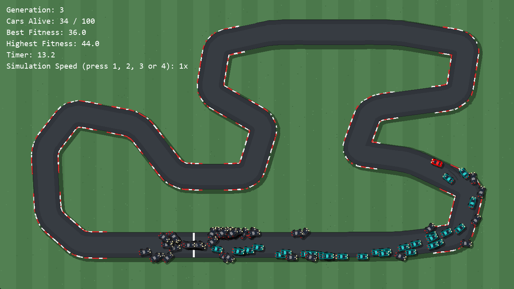

# CarSim
### A top-down car simulation that uses a neural network to make the cars learn to drive around the track.

## Installation and how to use
[**Download this!**](https://github.com/CharlieTheCatMeow/CarSim/releases/tag/v1.0.0)

Just download main.exe and run it. If Windows complains about it possibly being a virus or something, just ignore it and press run anyway.
(Press "More info" and then "Run anyway") 

There's also a brain.npz file to download that contains some pre-trained weights for the neural engine. 
Put it in the same folder as the executable, and you can load it in the options menu by pressing "Load brain"

You can press ESC to enter the pause menu to access the rest of the menus.

## Features:
- Tweak the car's stats
- Change the amount of cars on the track
- Change the track (there's a couple presets)
- Draw your own track
- Save and load already trained neural networks
- Some other stuff

## Useful keybinds:
- **H**: Show only the best car
- **1, 2, 3, 4**: Change the simulation speed
- **ESC**: Enter the pause menu
- **R**: Jump to the next generation
- **P**: Drive on the track yourself

## Screenshot!

## Why I made this (this section is sometimes needed I think)
I was interested in doing something involving neural networks, so I decided to do something that resembles this project.
I did this in 2d to not overcomplicate things. It turned out quite well I think :3

## AI Usage
A bit but not much, just some explaining of mechanics and bug fixing if I got stuck.